# DMC3 PSP Port

PSP-native port of **Devil May Cry 3: Dante's Awakening Special Edition** (`SLUS_213.61`) based on static R5900 analysis and conversion of the original game data.

## Screenshots

Captured from the port's own 480x272 framebuffer. About half were taken in PPSSPP 1.17.1 and half on a real PSP,
read back over PSPLINK. The models, textures and effects are read from the player's disc at build time; none are
stored in this repository.

The FPS counter in some shots is PPSSPP's, which runs the port at up to 60 FPS on a PC. On hardware the port
targets 30 FPS on the PSP-2000, 3000, Go and Street (and Adrenaline on Vita). The PSP-1000 isn't targeted: the current build
needs more than its 32 MB (the program alone is 16.4 MB, and the largest rooms load 4-5 MB each).

### Gameplay

| | |
| --- | --- |
|  |  |
| Mission 2: the Hell Vanguard boss fight | Red orbs, using CItemOrb's own effect and sizes |
|  |  |
| Mission 3: Cerberus in his chains | Ceiling icicles (em025's icicle model and effects) |
|  |  |
| The ice sphere, rolling toward Dante | Phase-two ice breath freezing the floor |
| 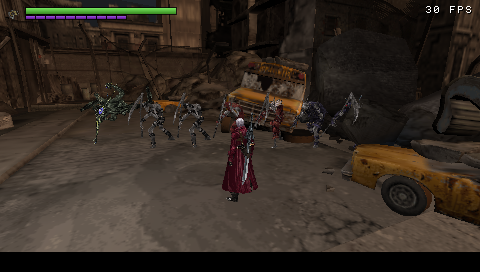 |  |
| Every enemy kind so far: the Enigma and all six Seven Hells | The Mission 2 street, at 60 FPS |
|  | 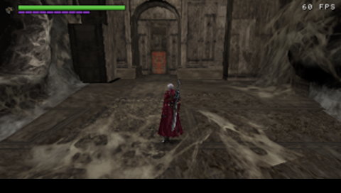 |
| A Mission 4 fight against the Seven Hells | Mission 4: the Gigapede passing overhead |
| 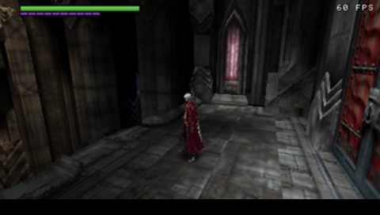 | 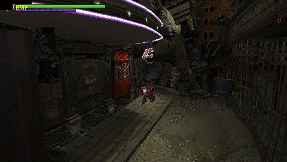 |
| Mission 4: the Astronomical Board | Rebellion's sword trail |
| 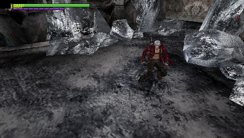 | 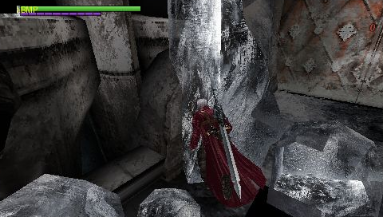 |
| Dante among giant ice crystals | |
| 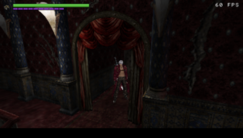 | 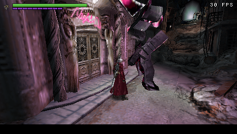 |
| Mission 3: the red curtain hall | Mission 3: inside the tower |
| 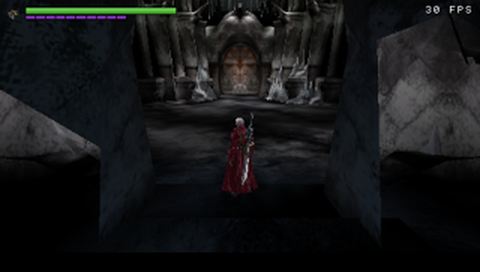 | 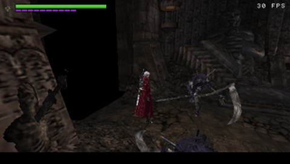 |
| Mission 3: the tower gate | Mission 4: surrounded by the Seven Hells |
| 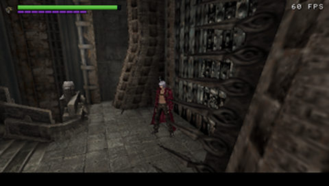 | 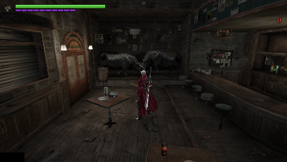 |
| Mission 4: the tower corridors | Mission 3: the bar, with its breakable props |
| 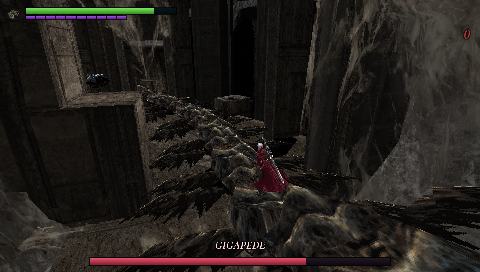 | 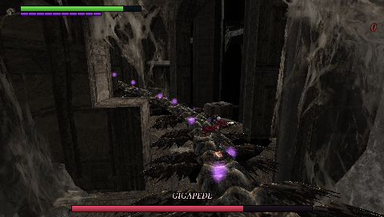 |
| Mission 4: standing on the Gigapede's back | Sparks run down it before it rolls to throw him off |
| 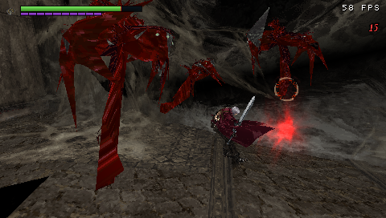 | 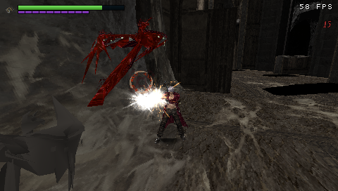 |
| Mission 5: Blood-goyles, split by the sword | Gunfire turns one to stone (bottom left) |
| 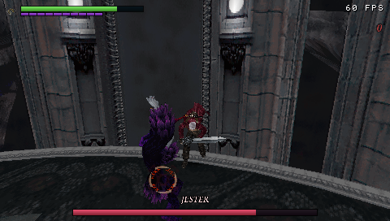 | 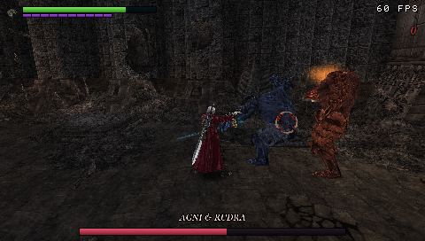 |
| Mission 5: the Jester, in his arena | Mission 5: Agni & Rudra |
| 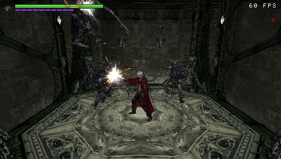 | |
| Mission 5: the Surge of Fortunas lift, the room's own model, with a wave dropped onto it | |
| 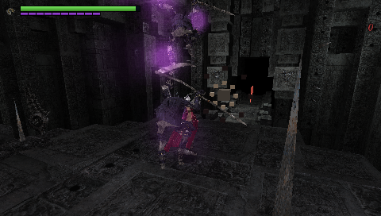 | 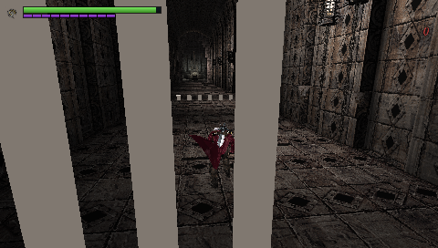 |
| Mission 6: the Trial of the Warrior, its crest switch and the barrier's mist | Mission 6: the Trial of Skill's spikes (a stand-in) |
| 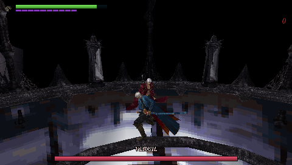 | 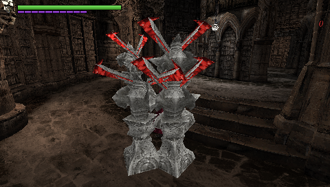 |
| Mission 7: Vergil on the Peak of Darkness, Yamato drawn | Mission 7: Damned Pawns closing in, in the Divine Library |
| 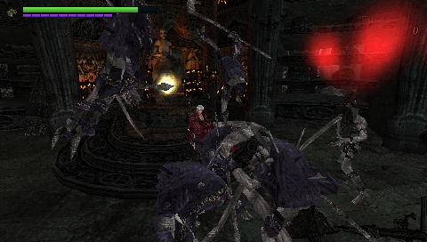 | |
| Mission 7: Hell Greeds and the Prides their coffins summoned | |
| 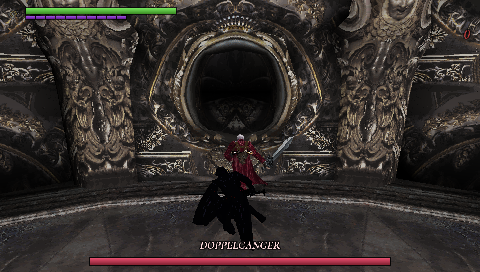 | 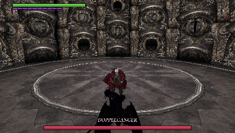 |
| Mission 17: the Doppelganger, Dante's shadow, reeling in a crest's light | Mission 17: up out of Dante's own shadow, behind him |
| 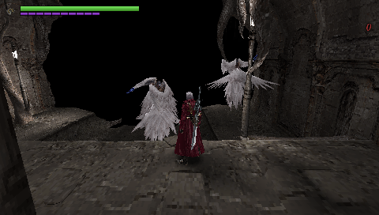 | 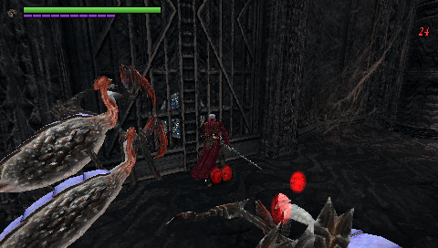 |
| Mission 15: two Fallen hovering round Dante in the Upper Subterran Garden | Mission 15: Arachnes in the Provisions Storeroom, by its flame portal |
| 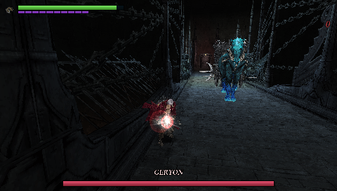 | 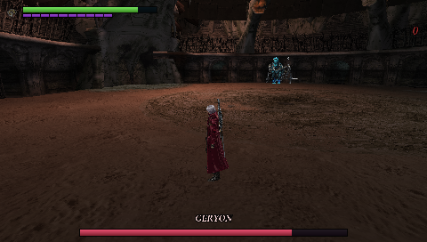 |
| Mission 12: Geryon and his carriage charging down the bridge | Mission 12: after the bridge falls, he gallops the ground below |
| 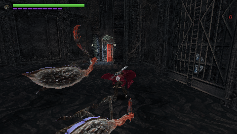 | 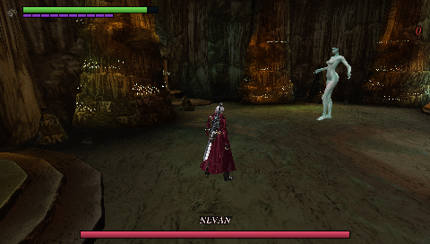 |
| Mission 9: Arachnes in the Provisions Storeroom | Mission 9: Nevan in the Sunken Opera House (her bats and dress aren't drawn yet) |
| 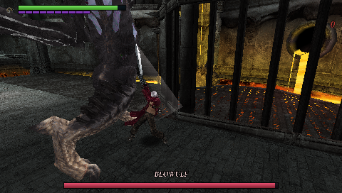 | 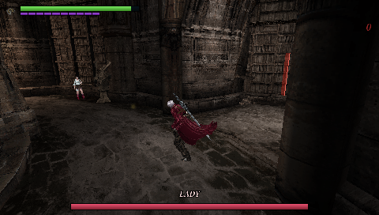 |
| Mission 11: Beowulf in the Torture Chamber | Mission 16: Lady in the Divine Library (left), keeping her distance |

### Menus

| | |
| --- | --- |
|  |  |
| Title screen | Mission Select, with Bloody Palace and the debug room |
|  |  |
| The Customize menu at the Divinity Statue | Buying items with red orbs |
| 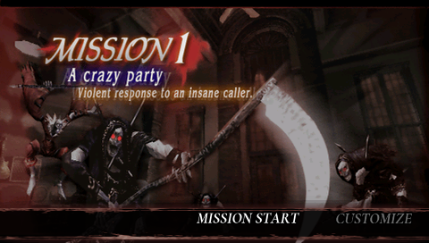 | 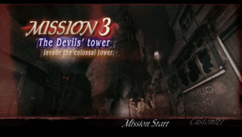 |
| The Mission 1 briefing card | Mission 3: The Devil's tower |
| 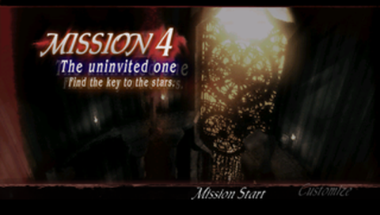 | 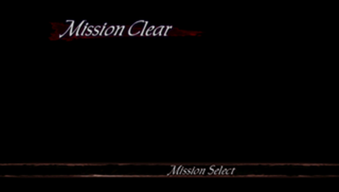 |
| Mission 4: The uninvited one | Mission Clear |

## Current verified state

- The PS2 ISO is verified by size and SHA-256.
- Ghidra's R5900 extension completes full analysis: **12,046 functions**, **1,106,277 instructions**, **36,211 call edges**, and **4,503 defined strings**.
- Random-access tools inventory all four AFS archives without extracting the whole ISO.
- GDATA inventory covers **3,183 PACs**, **680 raw assets**, **14,969 top-level chunks**, and **533 nested PACs**, with no malformed packs.
- All **87 standalone TIM2 assets** convert successfully to PNG/RGBA. The first MOD converts to 17 objects, 5,316 vertices, 5,282 triangles, and three correct character textures.
- The PSP runtime executes adapted gameplay routines and renders Dante with original geometry, UVs, and textures. Its current benchmark is **37.4 FPS** using a 240×136 model buffer upscaled to 480×272 with native-resolution UI.
- `MEMSIZE=1` targets PSP-2000/3000/Go/Street and Adrenaline on Vita at a 30 FPS budget. PSP-1000 isn't targeted: the current build needs more than its 32 MB.
- A freestanding Allegrex `EBOOT.PBP` builds and runs in **PPSSPP 1.17.1**. The runtime test requires PSP code to write `DMC3PSP_BOOT_OK` to the emulated memory stick.
- `TIME.txt` contains the timestamped work log. `analysis/autonomy-status.json` records the latest autonomous stage results.

Full scene execution, animation/deformation, audio, and gameplay remain in progress. See [docs/PORT_MAP.md](docs/PORT_MAP.md) for the technical map and next targets.

## What this repository contains

No game data is distributed here. The tools read assets from your own copy of the disc at build time, and their
output stays under the ignored `build/`. These are generated locally and kept out of Git:

- `analysis/ghidra/export/`: run `tools/run_ghidra.ps1`.
- `analysis/moveset/`: the moveset tools read the disc and that export.
- `psp/testroom/combat_data.h`: run `python tools/gen_combat_data.py`.
- `reference/dmc3-decomp/`: its sources come from the upstream commit in `UPSTREAM.json`.

## Reference implementation

`reference/dmc3-decomp/` vendors the CC0 matching-decomp source and metadata at commit `f8d03f05bef4f98598d9154b81044a0353b7927a`. It supplies named gameplay systems and class/vtable maps; the Special Edition Ghidra analysis remains the authority for `SLUS_213.61` differences. Adapted PSP implementations live under `engine/`.

## Autonomous verification

From the repository root:

```powershell
pwsh -File tools/autonomy.ps1
```

The default pass verifies the ISO, extracts boot files, inventories AFS/PAC data, exports Ghidra analysis, builds the PSP target, and runs the PPSSPP marker test. It writes every stage to `TIME.txt` and stops on the first failed stage.

Useful options:

```powershell
# Re-run the full ~3 minute R5900 auto-analysis before exporting
pwsh -File tools/autonomy.ps1 -FullAnalysis

# Fast loop without Ghidra or the full PAC scan
pwsh -File tools/autonomy.ps1 -SkipGhidra -SkipPacScan

# Build/analysis only; do not launch PPSSPP
pwsh -File tools/autonomy.ps1 -SkipRuntime
```

## Focused commands

```powershell
# Build the PSP EBOOT
pwsh -File tools/build_psp.ps1

# Deploy and verify under E:\SYSTEMS\PPSSPP
pwsh -File tools/test_ppsspp.ps1

# Re-export Ghidra maps and selected AFS functions
pwsh -File tools/run_ghidra.ps1 -Addresses 001aa8d0,00144dd0,00145258

# Inventory ISO/AFS data
python tools/dmc3_image.py inventory "path\to\game.iso" --output analysis

# Extract only boot files
python tools/dmc3_image.py extract-boot "path\to\game.iso" --output analysis/disc

# Inventory GDATA and nested PAC signatures
python tools/dmc3_pac.py inventory-gdata "path\to\game.iso" --output analysis/pac

# Extract one numeric GDATA member, then unpack its PAC chunks recursively
python tools/dmc3_image.py extract-afs-member "path\to\game.iso" GDATA.AFS 0 --output analysis/assets/gdata
python tools/dmc3_pac.py extract analysis/assets/gdata/00000.bin --output analysis/assets/gdata/slot_00000 --recursive

# Validate a packed EBOOT
python tools/pack_pbp.py --validate build/psp/EBOOT.PBP
```

## Layout

- `psp/` — freestanding PSP startup, runtime smoke target, and Allegrex linker script.
- `tools/autonomy.ps1` — ordered, logged, no-prompt verification pipeline.
- `tools/build_psp.ps1` — repo-local PSP GCC build and import fixup.
- `tools/test_ppsspp.ps1` — isolated PPSSPP process and PSP-written success marker.
- `tools/dmc3_image.py` — ISO9660/AFS reader and targeted extraction.
- `tools/dmc3_pac.py` — PAC/nested-PAC inventory and extraction.
- `tools/run_ghidra.ps1` — isolated JDK/Ghidra analysis and export.
- `tools/ghidra/` — Ghidra function/call/string/decompiler export scripts.
- `analysis/afs/` — AFS member manifests.
- `analysis/pac/` — streamed PAC index and format summary.
- `analysis/ghidra/export/` — function, call, string-xref, and decompilation outputs.
- `analysis/rea/evidence.json` — retained REA Evidence bundle.
- `analysis/ppsspp/` — emulator log and PSP-written boot evidence.

## Local toolchain

All downloaded tools are isolated under `.tools/` and excluded from Git. No global PATH, WSL, or system installer changes are required.

- PSP GCC 15.2.0 (`pspdev-win` v2), release-hash verified.
- Official PSPSDK source pinned to `1ecee3d9c521c660d008f8c6adb5dd97243b2cd4`.
- Ghidra 12.2 and `ghidra-emotionengine-reloaded` 2.1.39, release-hash verified.
- Eclipse Temurin JDK 25.0.5+8, release-hash verified.

The runtime test deploys the current EBOOT to `E:\SYSTEMS\PPSSPP\memstick\PSP\GAME\DMC3PSP\EBOOT.PBP`. It only closes or stops the PPSSPP process that it launched.


## Mission 7

From the Dark Corridor to Mission Clear: the Heavenrise Chamber's jump pads, Damned Pawns, Hell Greeds and their
coffins, the Orihalcon Fragment and the lift down to the Chamber of Echoes, the Siren's Shriek, the Cursed Skull
Chamber's ball, the Crystal Skull and the return ambush, and Vergil (CEm035, decoded) on the Peak of Darkness.
What's decoded and what's estimated: [the Vergil spec](docs/VERGIL_SPEC.md) and
[game flow](docs/GAME_FLOW.md#mission-7-a-chance-meeting).

## Mission 8

Leviathan's rooms, native Hell Envy, three animated boss organs, charged attacks, acid floors and the
five-eye exit seal are implemented. Ignis Fatuus is picked up in room 305 and used in room 302.
Nausika chases Dante through the tunnels. A scripted PPSSPP run verified the complete Ignis route and
full-health boss defeat to Mission Clear using ordinary gun damage. Fidelity limits are recorded in
[the Leviathan spec](docs/LEVIATHAN_SPEC.md) and [game flow](docs/GAME_FLOW.md#mission-8-leviathan).

## Mission 17

From the Dark Corridor to the Dark-pact Chamber: the Trial of Wisdom's Dullahans, the Trial of Skill's red pod, the
Skull Spire, and the Doppelganger (CEm034: its own model and Dante's moves, decoded state choices) in Apparition
Incarnate, where only the light of the crests Dante opens lets a blade bite. What's decoded and what's estimated:
[the Doppelganger spec](docs/DOPPELGANGER_SPEC.md) and [game flow](docs/GAME_FLOW.md#mission-17-inner-demons).

## Mission 15

From the Upper Subterran Garden to Mission Clear: the Fallen (CEm011, its own model, motions and decoded hover and
attack picks), the flame portals and the coloured doors they turn, the three Orihalcon Fragments and the
Devilsprout Lift up to the Sun & Moon Chamber. What's decoded and what's estimated: [the Fallen spec](docs/FALLEN_SPEC.md)
and [game flow](docs/GAME_FLOW.md#mission-15-the-gatecrasher).

## Mission 12

From the Torture Chamber to Mission Clear: the Temperance Wagon's ride, the Blood-goyle rooms, the Marble
Throughway and the Rotating Bridge, and Geryon (CEm029, his horse and carriage from em029) on the bridge and, once
it falls, on the ground below. What's decoded and what's estimated: [the Geryon spec](docs/GERYON_SPEC.md) and
[game flow](docs/GAME_FLOW.md#mission-12-hunting-the-hunter).

## Mission 10

M10 runs from the Limestone Cavern to Mission Clear: Stone Mask, lake bridge, Neo-Generator,
return encounters, rotating bridge and the Marble Throughway clear trigger. Dullahans use their
native shield model and motions with a simplified rear-weakness/charge AI. Bridge animation and
collision are approximations; see [Mission 10 implementation notes](docs/MISSION10_SPEC.md).
The scripted PPSSPP route uses placements and minion clears to isolate progression, and walks
Dante across the powered bridge using normal movement.
