# DMC3 PSP Port

PSP-native port of **Devil May Cry 3: Dante's Awakening Special Edition** (`SLUS_213.61`) based on static R5900 analysis and conversion of the original game data.

## Screenshots

Captured from the port's own 480x272 framebuffer. About half were taken in PPSSPP 1.17.1 and half on a real PSP,
read back over PSPLINK. The models, textures and effects are read from the player's disc at build time; none are
stored in this repository.

The FPS counter in some shots is PPSSPP's, which runs the port at up to 60 FPS on a PC. On hardware the port
targets 30 FPS on the PSP-2000, 3000, Go and Street (and Adrenaline on Vita). The PSP-1000 isn't targeted: the current build
needs more than its 32 MB (the program alone is 16.4 MB, and the largest rooms load 4-5 MB each).

### Gameplay

| | |
| --- | --- |
| 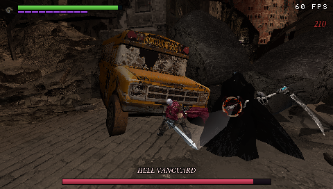 | 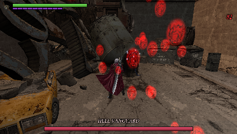 |
| Mission 2: the Hell Vanguard boss fight | Red orbs, using CItemOrb's own effect and sizes |
| 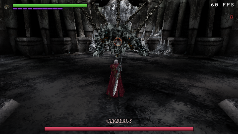 | 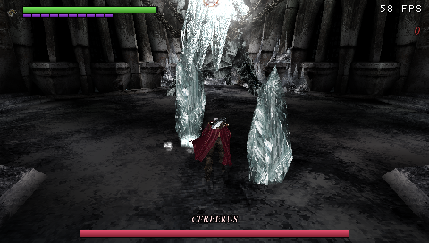 |
| Mission 3: Cerberus in his chains | Ceiling icicles (em025's icicle model and effects) |
| 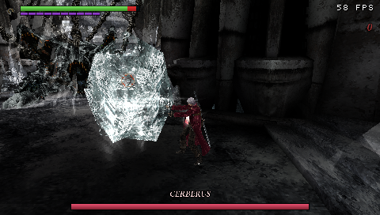 | 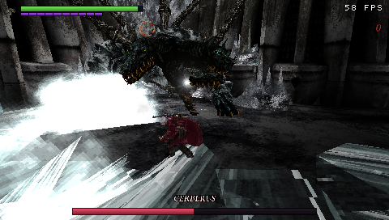 |
| The ice sphere, rolling toward Dante | Phase-two ice breath freezing the floor |
| 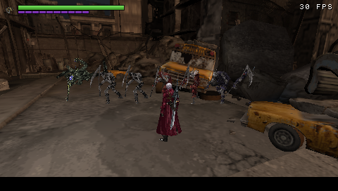 | 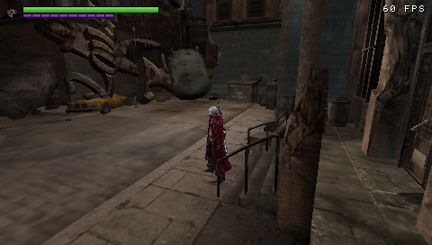 |
| Every enemy kind so far: the Enigma and all six Seven Hells | The Mission 2 street, at 60 FPS |
| 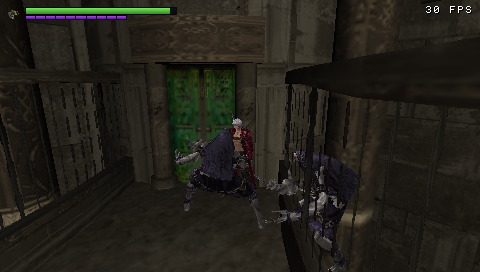 | 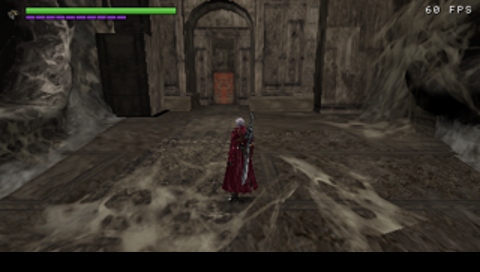 |
| A Mission 4 fight against the Seven Hells | Mission 4: the Gigapede passing overhead |
| 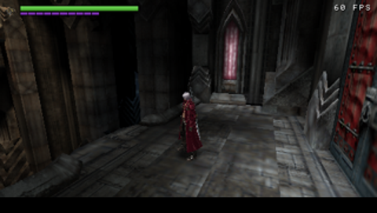 | 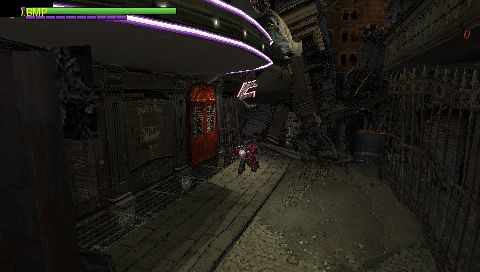 |
| Mission 4: the Astronomical Board | Rebellion's sword trail |
| 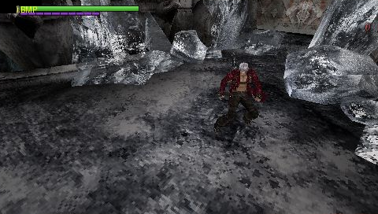 | 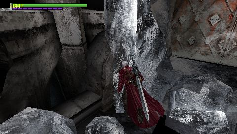 |
| Dante among giant ice crystals | |
| 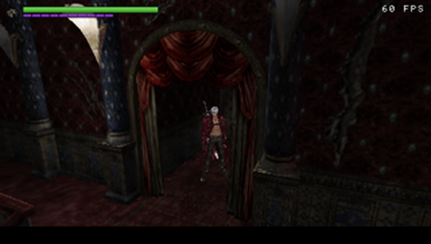 | 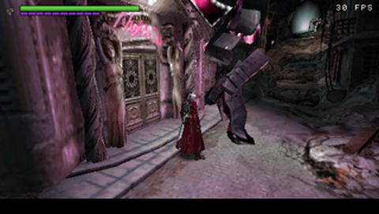 |
| Mission 3: the red curtain hall | Mission 3: inside the tower |
| 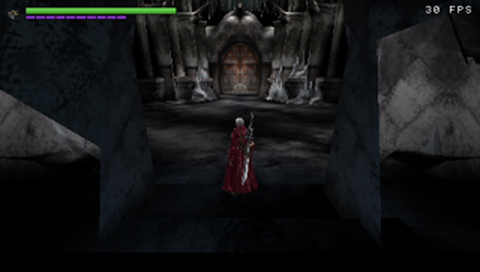 | 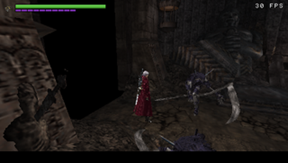 |
| Mission 3: the tower gate | Mission 4: surrounded by the Seven Hells |
| 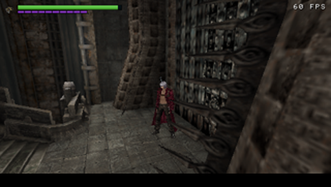 | 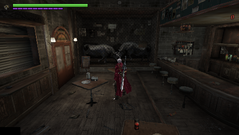 |
| Mission 4: the tower corridors | Mission 3: the bar, with its breakable props |
| 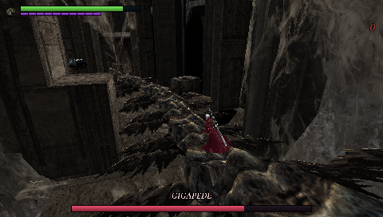 | 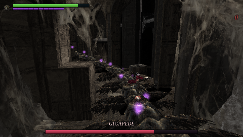 |
| Mission 4: standing on the Gigapede's back | Sparks run down it before it rolls to throw him off |
| 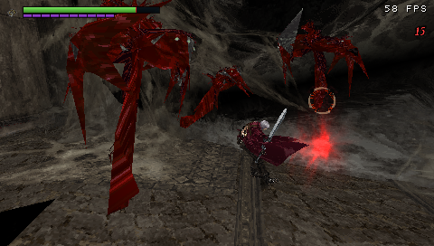 | 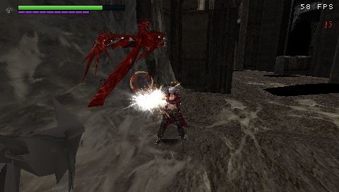 |
| Mission 5: Blood-goyles, split by the sword | Gunfire turns one to stone (bottom left) |
| 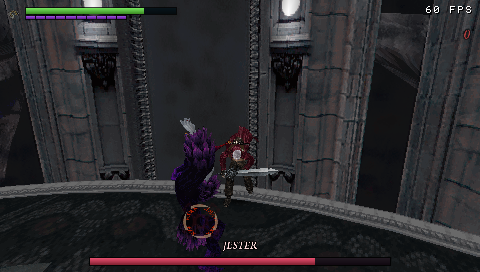 | 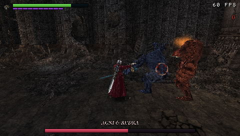 |
| Mission 5: the Jester, in his arena | Mission 5: Agni & Rudra |
| 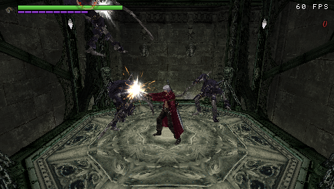 | |
| Mission 5: the Surge of Fortunas lift, the room's own model, with a wave dropped onto it | |
| 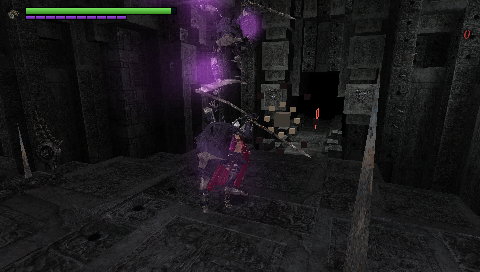 | 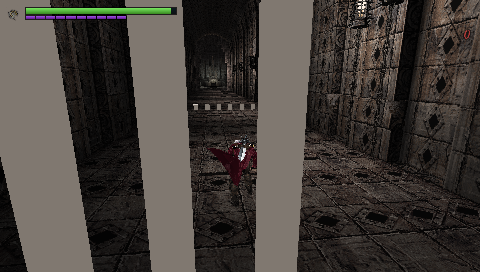 |
| Mission 6: the Trial of the Warrior, its crest switch and the barrier's mist | Mission 6: the Trial of Skill's spikes (a stand-in) |
| 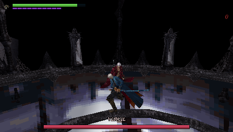 | 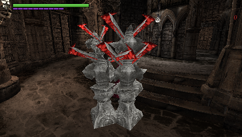 |
| Mission 7: Vergil on the Peak of Darkness, Yamato drawn | Mission 7: Damned Pawns closing in, in the Divine Library |
| 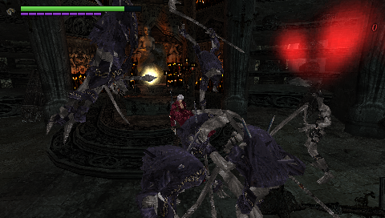 | |
| Mission 7: Hell Greeds and the Prides their coffins summoned | |
| 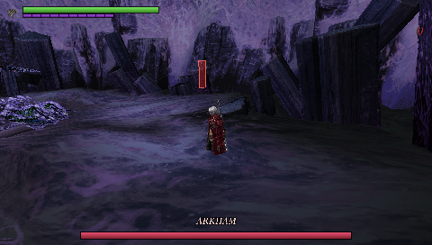 | 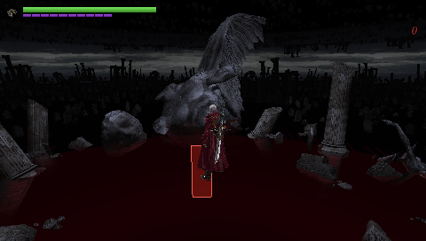 |
| Mission 19: a Legion closing on Dante in Forbidden Nirvana | Mission 19: the Netherworld's Room of Fallen Ones |
| 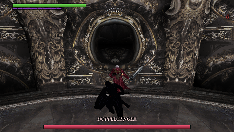 | 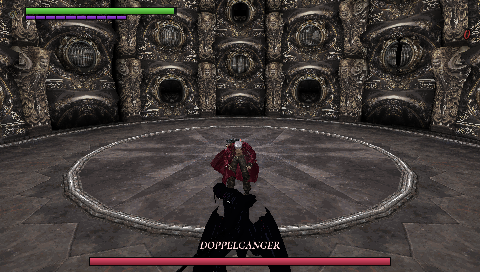 |
| Mission 17: the Doppelganger, Dante's shadow, reeling in a crest's light | Mission 17: up out of Dante's own shadow, behind him |
| 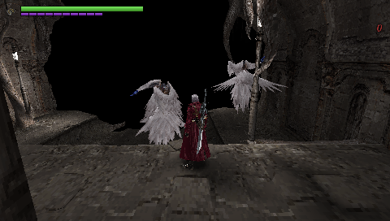 | 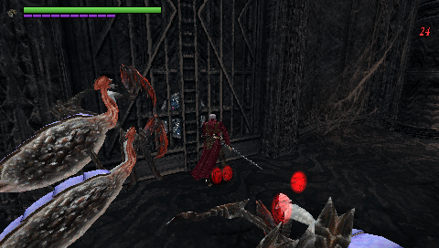 |
| Mission 15: two Fallen hovering round Dante in the Upper Subterran Garden | Mission 15: Arachnes in the Provisions Storeroom, by its flame portal |
| 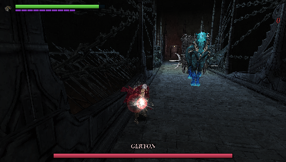 | 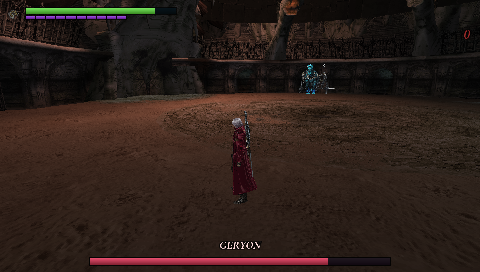 |
| Mission 12: Geryon and his carriage charging down the bridge | Mission 12: after the bridge falls, he gallops the ground below |
| 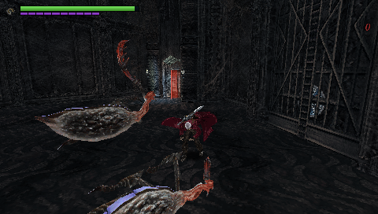 | 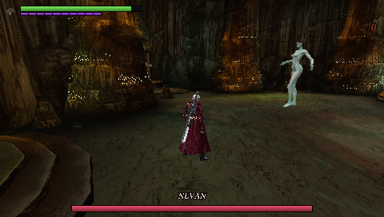 |
| Mission 9: Arachnes in the Provisions Storeroom | Mission 9: Nevan in the Sunken Opera House (her bats and dress aren't drawn yet) |
| 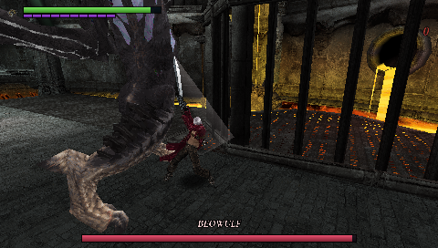 | 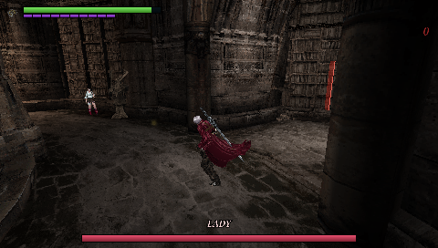 |
| Mission 11: Beowulf in the Torture Chamber | Mission 16: Lady in the Divine Library (left), keeping her distance |

### Menus

| | |
| --- | --- |
| 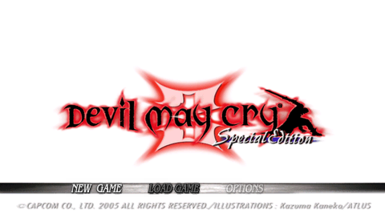 | 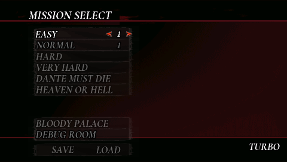 |
| Title screen | Mission Select, with Bloody Palace and the debug room |
| 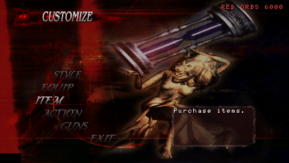 | 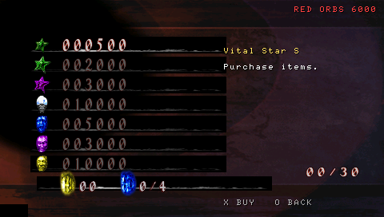 |
| The Customize menu at the Divinity Statue | Buying items with red orbs |
| 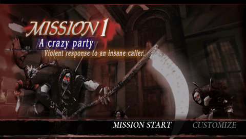 | 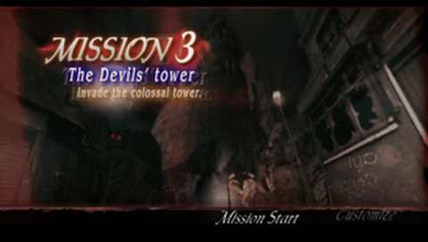 |
| The Mission 1 briefing card | Mission 3: The Devil's tower |
|  |  |
| Mission 4: The uninvited one | Mission Clear |

## Missions

All 20 missions play from Mission Select to Mission Clear, with each room's enemies, doors and gimmicks from the game's
own data and event scripts. Each mission's boss room or route was re-run to Mission Clear in PPSSPP on 2026-11-14 (the
[regression sweep](docs/GAME_FLOW.md#regression-sweep-2026-11-14-master-98e84b6-with-missions-1-20)). The table says what each
mission adds, what's still estimated, and where the details are. Things missing everywhere: real-time cutscenes, music and
sound effects, saves, and Dante dying.

| Mission | Plays | Approximated | Details |
| --- | --- | --- | --- |
| 1 | Prides, then the later waves, from the event script | Easy and Normal columns only; no real-time cutscenes | [game flow](docs/GAME_FLOW.md#game-flow-menus-cutscenes-and-missions-1-and-2) |
| 2 | The street's groups, then the Hell Vanguard (class decoded) | Parts of his fight are estimates (see the spec); Mission 2's intro event isn't run | [Vanguard spec](docs/VANGUARD_SPEC.md) |
| 3 | The tower's rooms, Bullseye's crest switch and blue seal, Cerberus | Some of Cerberus's timings and damage | [Cerberus spec](docs/CERBERUS_SPEC.md), [Bullseye spec](docs/BAR_CRANK_SPEC.md) |
| 4 | Lifts, seals, the Gigapede, the Astronomical Board | Seal models are tinted boards | [game flow](docs/GAME_FLOW.md#mission-4-find-the-key-to-the-stars) |
| 5 | Blood-goyles, the Jester, the Soul of Steel, the Surge of Fortunas lift, Agni & Rudra | The Jester's and Agni & Rudra's fights are simplified; the pit bridge is plain steps | [game flow](docs/GAME_FLOW.md#mission-5-of-devils-and-swords) |
| 6 | The three trials, the Trial of Skill's spikes, the barrier mist | The spikes are a stand-in | [game flow](docs/GAME_FLOW.md#mission-6-family-ties) |
| 7 | Jump pads, Pawns, Greeds and coffins, Vergil (CEm035 decoded) | Some of Vergil's damage and timing | [Vergil spec](docs/VERGIL_SPEC.md) |
| 8 | Leviathan's rooms and organs, Hell Envy, Nausika, Ignis Fatuus | Organ attacks partly estimated | [Leviathan spec](docs/LEVIATHAN_SPEC.md) |
| 9 | Arachnes, the light-beam room, Nevan | Nevan's fight is a stand-in (her bats and dress aren't drawn); 203's beam is reset by its panel | [game flow](docs/GAME_FLOW.md#mission-9-faded-memories) |
| 10 | Stone Mask, the lake bridge, Neo-Generator, Dullahans | Bridge animation and collision; Dullahan AI simplified | [Mission 10 notes](docs/MISSION10_SPEC.md) |
| 11 | Beowulf in the Torture Chamber, the Rotating Bridge route | Beowulf's fight is a stand-in from the walkthrough | [game flow](docs/GAME_FLOW.md#mission-11-revenge) |
| 12 | The Temperance Wagon, Geryon on the bridge and the ground | Some of Geryon's timings | [Geryon spec](docs/GERYON_SPEC.md) |
| 13 | The crystal-light grid, Damned Bishops, Vergil with Beowulf | Bishop and boss estimates | [Mission 13 notes](docs/MISSION13_SPEC.md) |
| 14 | Lair of Judgement to 13th Avenue: the combat adjudicator, Hell's Highway's chessmen | The adjudicator takes 20 hits of any weapon; the maze panels stay put; the other chessmen spawn as Pawns | [game flow](docs/GAME_FLOW.md#mission-14-drive) |
| 15 | The Fallen (decoded picks), flame portals, the Devilsprout Lift | Fallen damage and timings | [Fallen spec](docs/FALLEN_SPEC.md) |
| 16 | Lady in the Divine Library | Her fight is a stand-in: her class isn't decoded | [game flow](docs/GAME_FLOW.md#mission-16-win-or-lose) |
| 17 | The trials, the Doppelganger (decoded state choices) | Crest light and some timings | [Doppelganger spec](docs/DOPPELGANGER_SPEC.md) |
| 18 | The boss rush through 403's nine doors, the bingo board | The board's own rule is read as a 3 x 3 line | [game flow](docs/GAME_FLOW.md#mission-18-invading-hell) |
| 19 | The Nirvanas, Arkham and his Legions, both rounds | Some of Arkham's attacks | [Arkham spec](docs/ARKHAM_SPEC.md) |
| 20 | Vergil's final fight with Devil Trigger, the ending street | The ending's cinematic and Lady ally | [Mission 20 notes](docs/MISSION20_SPEC.md) |

### Secret Missions

All twelve play to their clear. Each is entered at its red structure in a main mission's room, played in its own
room (st600-st611), and ends with Dante back where he came in. The rules are the game's own, as its mission screen
states them; the clear checks are the port's, because their code isn't decoded. Each was played to its clear in
PPSSPP. Details: [the Secret Missions table](docs/GAME_FLOW.md#secret-missions).

| # | Rule | Notes |
| --- | --- | --- |
| 1 | Beat every enemy | The rule is inferred from the room |
| 2 | Beat 4 Enigmas without being hurt | |
| 3 | Stay in the air for 20 seconds | |
| 4 | Ride the elevator to the top | |
| 5 | Break every prop within 40 seconds | |
| 6 | Collect every red orb | Reached with Air Raid, Nevan's Devil Trigger flight (from player states 0x25-0x28); no time limit yet |
| 7 | Reach the Blue Orb within 30 seconds | Devil Trigger's run, measured on the PS2, clears it in about 28.6 s |
| 8 | Beat every enemy | Arachnes and Hell Vanguards |
| 9 | Let no enemy escape the wagons | The wagons' timetable is the walkthrough's; the cart and track are the room's own |
| 10 | Solve the crystal puzzle | CStageSetCrystal decoded, its layouts read from the executable |
| 11 | Avoid the spikes and reach the Blue Orb | The spike trap isn't in |
| 12 | Reach the Blue Orb Fragment | The moving blocks aren't in |

## Current verified state

- The PS2 ISO is verified by size and SHA-256.
- Ghidra's R5900 extension completes full analysis: **12,046 functions**, **1,106,277 instructions**, **36,211 call edges**, and **4,503 defined strings**.
- Random-access tools inventory all four AFS archives without extracting the whole ISO.
- GDATA inventory covers **3,183 PACs**, **680 raw assets**, **14,969 top-level chunks**, and **533 nested PACs**, with no malformed packs.
- All **87 standalone TIM2 assets** convert successfully to PNG/RGBA. The first MOD converts to 17 objects, 5,316 vertices, 5,282 triangles, and three correct character textures.
- The PSP runtime plays all 20 missions and the 12 Secret Missions with the game's own stages, models, motions and textures, holding 30 FPS on a real PSP in the benchmark scenes (`tools/psp_bench.py`, results in `analysis/testroom/bench_*.txt`).
- `MEMSIZE=1` targets PSP-2000/3000/Go/Street and Adrenaline on Vita at a 30 FPS budget. PSP-1000 isn't targeted: the current build needs more than its 32 MB.
- A freestanding Allegrex `EBOOT.PBP` builds and runs in **PPSSPP 1.17.1**. The runtime test requires PSP code to write `DMC3PSP_BOOT_OK` to the emulated memory stick.
- `TIME.txt` contains the timestamped work log. `analysis/autonomy-status.json` records the latest autonomous stage results.

Real-time cutscenes, audio outside movies, saves and Game Over remain to do. See [docs/PORT_MAP.md](docs/PORT_MAP.md) for the technical map and [docs/GAME_FLOW.md](docs/GAME_FLOW.md#next-steps-in-order) for the next steps.

## What this repository contains

No game data is distributed here. The tools read assets from your own copy of the disc at build time, and their
output stays under the ignored `build/`. These are generated locally and kept out of Git:

- `analysis/ghidra/export/`: run `tools/run_ghidra.ps1`.
- `analysis/moveset/`: the moveset tools read the disc and that export.
- `psp/testroom/combat_data.h`: run `python tools/gen_combat_data.py`.
- `reference/dmc3-decomp/`: its sources come from the upstream commit in `UPSTREAM.json`.

## Reference implementation

`reference/dmc3-decomp/` vendors the CC0 matching-decomp source and metadata at commit `f8d03f05bef4f98598d9154b81044a0353b7927a`. It supplies named gameplay systems and class/vtable maps; the Special Edition Ghidra analysis remains the authority for `SLUS_213.61` differences. Adapted PSP implementations live under `engine/`.

## Autonomous verification

From the repository root:

```powershell
pwsh -File tools/autonomy.ps1
```

The default pass verifies the ISO, extracts boot files, inventories AFS/PAC data, exports Ghidra analysis, builds the PSP target, and runs the PPSSPP marker test. It writes every stage to `TIME.txt` and stops on the first failed stage.

Useful options:

```powershell
# Re-run the full ~3 minute R5900 auto-analysis before exporting
pwsh -File tools/autonomy.ps1 -FullAnalysis

# Fast loop without Ghidra or the full PAC scan
pwsh -File tools/autonomy.ps1 -SkipGhidra -SkipPacScan

# Build/analysis only; do not launch PPSSPP
pwsh -File tools/autonomy.ps1 -SkipRuntime
```

## Focused commands

```powershell
# Build the PSP EBOOT
pwsh -File tools/build_psp.ps1

# Deploy and verify under E:\SYSTEMS\PPSSPP
pwsh -File tools/test_ppsspp.ps1

# Re-export Ghidra maps and selected AFS functions
pwsh -File tools/run_ghidra.ps1 -Addresses 001aa8d0,00144dd0,00145258

# Inventory ISO/AFS data
python tools/dmc3_image.py inventory "path\to\game.iso" --output analysis

# Extract only boot files
python tools/dmc3_image.py extract-boot "path\to\game.iso" --output analysis/disc

# Inventory GDATA and nested PAC signatures
python tools/dmc3_pac.py inventory-gdata "path\to\game.iso" --output analysis/pac

# Extract one numeric GDATA member, then unpack its PAC chunks recursively
python tools/dmc3_image.py extract-afs-member "path\to\game.iso" GDATA.AFS 0 --output analysis/assets/gdata
python tools/dmc3_pac.py extract analysis/assets/gdata/00000.bin --output analysis/assets/gdata/slot_00000 --recursive

# Validate a packed EBOOT
python tools/pack_pbp.py --validate build/psp/EBOOT.PBP
```

## Layout

- `psp/` — freestanding PSP startup, runtime smoke target, and Allegrex linker script.
- `tools/autonomy.ps1` — ordered, logged, no-prompt verification pipeline.
- `tools/build_psp.ps1` — repo-local PSP GCC build and import fixup.
- `tools/test_ppsspp.ps1` — isolated PPSSPP process and PSP-written success marker.
- `tools/dmc3_image.py` — ISO9660/AFS reader and targeted extraction.
- `tools/dmc3_pac.py` — PAC/nested-PAC inventory and extraction.
- `tools/run_ghidra.ps1` — isolated JDK/Ghidra analysis and export.
- `tools/ghidra/` — Ghidra function/call/string/decompiler export scripts.
- `analysis/afs/` — AFS member manifests.
- `analysis/pac/` — streamed PAC index and format summary.
- `analysis/ghidra/export/` — function, call, string-xref, and decompilation outputs.
- `analysis/rea/evidence.json` — retained REA Evidence bundle.
- `analysis/ppsspp/` — emulator log and PSP-written boot evidence.

## Local toolchain

All downloaded tools are isolated under `.tools/` and excluded from Git. No global PATH, WSL, or system installer changes are required.

- PSP GCC 15.2.0 (`pspdev-win` v2), release-hash verified.
- Official PSPSDK source pinned to `1ecee3d9c521c660d008f8c6adb5dd97243b2cd4`.
- Ghidra 12.2 and `ghidra-emotionengine-reloaded` 2.1.39, release-hash verified.
- Eclipse Temurin JDK 25.0.5+8, release-hash verified.

The runtime test deploys the current EBOOT to `E:\SYSTEMS\PPSSPP\memstick\PSP\GAME\DMC3PSP\EBOOT.PBP`. It only closes or stops the PPSSPP process that it launched.
