# DMC3 PSP Port

PSP-native port of **Devil May Cry 3: Dante's Awakening Special Edition** (`SLUS_213.61`) based on static R5900 analysis and conversion of the original game data.

## Screenshots

Captured from the port's own 480x272 framebuffer. About half were taken in PPSSPP 1.17.1 and half on a real PSP,
read back over PSPLINK. The models, textures and effects are read from the player's disc at build time; none are
stored in this repository.

### Gameplay

| | |
| --- | --- |
| 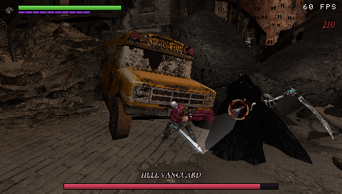 | 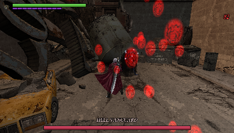 |
| Mission 2: the Hell Vanguard boss fight | Red orbs, using CItemOrb's own effect and sizes |
| 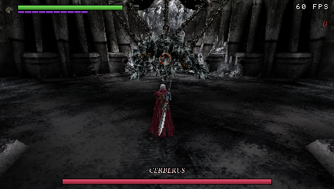 | 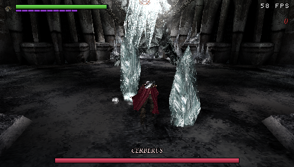 |
| Mission 3: Cerberus in his chains | Ceiling icicles (em025's icicle model and effects) |
| 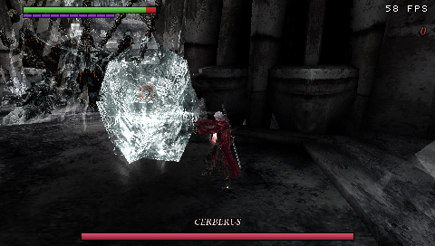 | 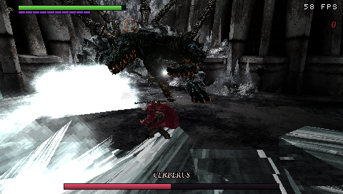 |
| The ice sphere, rolling toward Dante | Phase-two ice breath freezing the floor |
| 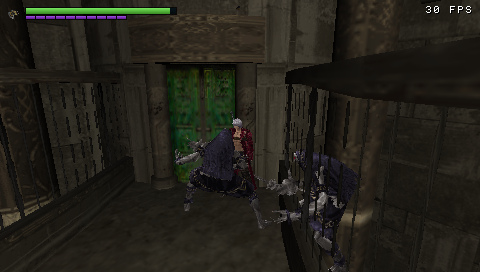 | 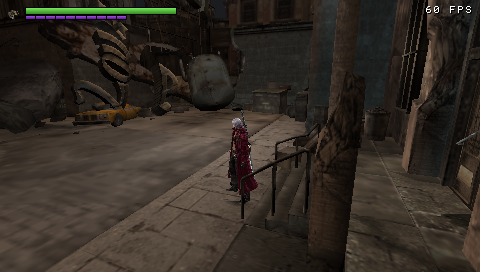 |
| A Mission 4 fight against the Seven Hells | The Mission 2 street, at 60 FPS |

### Menus

| | |
| --- | --- |
| 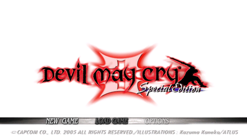 | 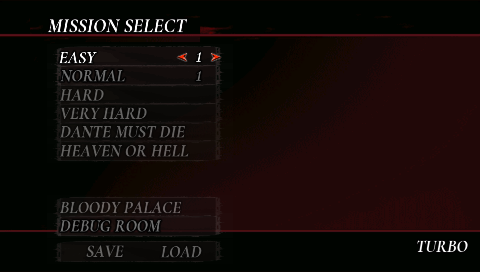 |
| Title screen | Mission Select, with Bloody Palace and the debug room |
| 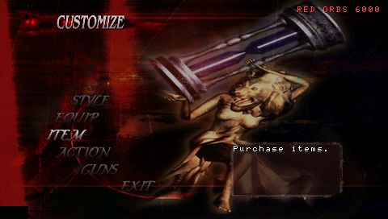 | 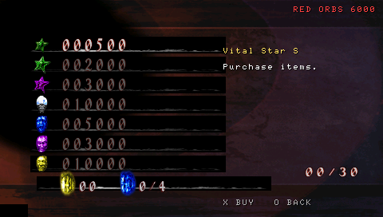 |
| The Customize menu at the Divinity Statue | Buying items with red orbs |

## Current verified state

- The PS2 ISO is verified by size and SHA-256.
- Ghidra's R5900 extension completes full analysis: **12,046 functions**, **1,106,277 instructions**, **36,211 call edges**, and **4,503 defined strings**.
- Random-access tools inventory all four AFS archives without extracting the whole ISO.
- GDATA inventory covers **3,183 PACs**, **680 raw assets**, **14,969 top-level chunks**, and **533 nested PACs**, with no malformed packs.
- All **87 standalone TIM2 assets** convert successfully to PNG/RGBA. The first MOD converts to 17 objects, 5,316 vertices, 5,282 triangles, and three correct character textures.
- The PSP runtime executes adapted gameplay routines and renders Dante with original geometry, UVs, and textures. Its current benchmark is **37.4 FPS** using a 240×136 model buffer upscaled to 480×272 with native-resolution UI.
- `MEMSIZE=1` targets PSP-2000/3000/Go/Street and Adrenaline on Vita at a 30 FPS budget; PSP-1000 is out of scope.
- A freestanding Allegrex `EBOOT.PBP` builds and runs in **PPSSPP 1.17.1**. The runtime test requires PSP code to write `DMC3PSP_BOOT_OK` to the emulated memory stick.
- `TIME.txt` contains the timestamped work log. `analysis/autonomy-status.json` records the latest autonomous stage results.

Full scene execution, animation/deformation, audio, and gameplay remain in progress. See [docs/PORT_MAP.md](docs/PORT_MAP.md) for the technical map and next targets.

## What this repository contains

No game data is distributed here. The tools read assets from your own copy of the disc at build time, and their
output stays under the ignored `build/`. These are generated locally and kept out of Git:

- `analysis/ghidra/export/`: run `tools/run_ghidra.ps1`.
- `analysis/moveset/`: the moveset tools read the disc and that export.
- `psp/testroom/combat_data.h`: run `python tools/gen_combat_data.py`.
- `reference/dmc3-decomp/`: its sources come from the upstream commit in `UPSTREAM.json`.

## Reference implementation

`reference/dmc3-decomp/` vendors the CC0 matching-decomp source and metadata at commit `f8d03f05bef4f98598d9154b81044a0353b7927a`. It supplies named gameplay systems and class/vtable maps; the Special Edition Ghidra analysis remains the authority for `SLUS_213.61` differences. Adapted PSP implementations live under `engine/`.

## Autonomous verification

From the repository root:

```powershell
pwsh -File tools/autonomy.ps1
```

The default pass verifies the ISO, extracts boot files, inventories AFS/PAC data, exports Ghidra analysis, builds the PSP target, and runs the PPSSPP marker test. It writes every stage to `TIME.txt` and stops on the first failed stage.

Useful options:

```powershell
# Re-run the full ~3 minute R5900 auto-analysis before exporting
pwsh -File tools/autonomy.ps1 -FullAnalysis

# Fast loop without Ghidra or the full PAC scan
pwsh -File tools/autonomy.ps1 -SkipGhidra -SkipPacScan

# Build/analysis only; do not launch PPSSPP
pwsh -File tools/autonomy.ps1 -SkipRuntime
```

## Focused commands

```powershell
# Build the PSP EBOOT
pwsh -File tools/build_psp.ps1

# Deploy and verify under E:\SYSTEMS\PPSSPP
pwsh -File tools/test_ppsspp.ps1

# Re-export Ghidra maps and selected AFS functions
pwsh -File tools/run_ghidra.ps1 -Addresses 001aa8d0,00144dd0,00145258

# Inventory ISO/AFS data
python tools/dmc3_image.py inventory "path\to\game.iso" --output analysis

# Extract only boot files
python tools/dmc3_image.py extract-boot "path\to\game.iso" --output analysis/disc

# Inventory GDATA and nested PAC signatures
python tools/dmc3_pac.py inventory-gdata "path\to\game.iso" --output analysis/pac

# Extract one numeric GDATA member, then unpack its PAC chunks recursively
python tools/dmc3_image.py extract-afs-member "path\to\game.iso" GDATA.AFS 0 --output analysis/assets/gdata
python tools/dmc3_pac.py extract analysis/assets/gdata/00000.bin --output analysis/assets/gdata/slot_00000 --recursive

# Validate a packed EBOOT
python tools/pack_pbp.py --validate build/psp/EBOOT.PBP
```

## Layout

- `psp/` — freestanding PSP startup, runtime smoke target, and Allegrex linker script.
- `tools/autonomy.ps1` — ordered, logged, no-prompt verification pipeline.
- `tools/build_psp.ps1` — repo-local PSP GCC build and import fixup.
- `tools/test_ppsspp.ps1` — isolated PPSSPP process and PSP-written success marker.
- `tools/dmc3_image.py` — ISO9660/AFS reader and targeted extraction.
- `tools/dmc3_pac.py` — PAC/nested-PAC inventory and extraction.
- `tools/run_ghidra.ps1` — isolated JDK/Ghidra analysis and export.
- `tools/ghidra/` — Ghidra function/call/string/decompiler export scripts.
- `analysis/afs/` — AFS member manifests.
- `analysis/pac/` — streamed PAC index and format summary.
- `analysis/ghidra/export/` — function, call, string-xref, and decompilation outputs.
- `analysis/rea/evidence.json` — retained REA Evidence bundle.
- `analysis/ppsspp/` — emulator log and PSP-written boot evidence.

## Local toolchain

All downloaded tools are isolated under `.tools/` and excluded from Git. No global PATH, WSL, or system installer changes are required.

- PSP GCC 15.2.0 (`pspdev-win` v2), release-hash verified.
- Official PSPSDK source pinned to `1ecee3d9c521c660d008f8c6adb5dd97243b2cd4`.
- Ghidra 12.2 and `ghidra-emotionengine-reloaded` 2.1.39, release-hash verified.
- Eclipse Temurin JDK 25.0.5+8, release-hash verified.

The runtime test deploys the current EBOOT to `E:\SYSTEMS\PPSSPP\memstick\PSP\GAME\DMC3PSP\EBOOT.PBP`. It only closes or stops the PPSSPP process that it launched.
